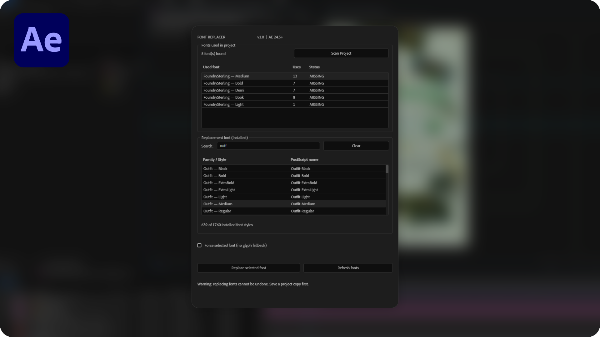

# Font Replacer for After Effects

A simple dockable script for Adobe After Effects that scans all fonts used in your project and lets you replace them with installed fonts in just a few clicks.

## Features

- Scan all fonts used in your project.
- Detect missing fonts.
- Browse and search installed fonts.
- Replace fonts across all compositions.
- Preserve existing text formatting.

## Installation

**Method 1 – Install as a Dockable Panel**

1. Download [`Font_Replacer_AE.jsx`](./Font_Replacer_AE.jsx).
2. Copy the file to your After Effects installation folder:
   `Support Files/Scripts/ScriptUI Panels/`
3. Restart After Effects.
4. Open **Window → Font_Replacer_AE.jsx**.

**Method 2 – Run Directly**

1. Download [`Font_Replacer_AE.jsx`](./Font_Replacer_AE.jsx).
2. In After Effects, go to **File → Scripts → Run Script File...**
3. Select the downloaded `.jsx` file.

Alternatively, use **File → Scripts → Install ScriptUI Panel...** (if available in your After Effects version), then restart After Effects and open the panel from the **Window** menu.

## How to Use

1. Click **Scan Project**.
2. Select a font from the detected fonts list.
3. Choose a replacement font.
4. Click **Replace selected font**.

## Requirements

- Adobe After Effects 2024 (24.5) or newer.

## Notes

Save a backup of your project before replacing fonts. Font replacement cannot be undone using Ctrl+Z.

## License

Free to use, modify, and distribute.
